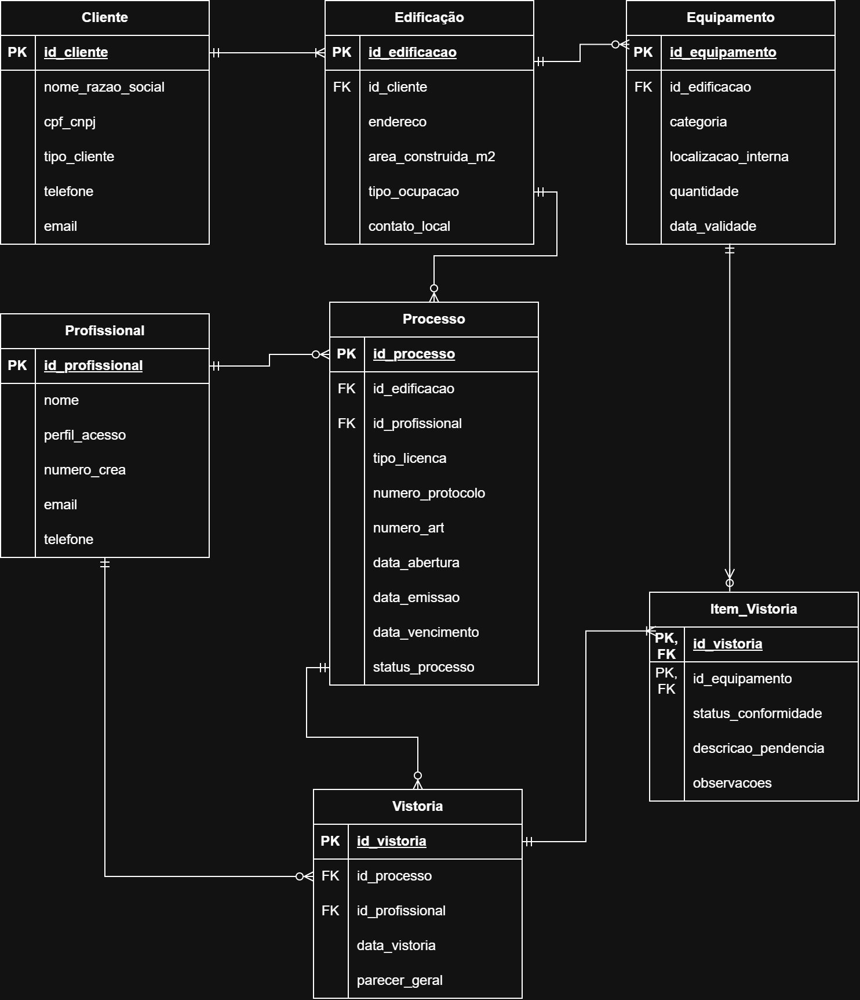

# FireTrack — Modelagem de Banco de Dados (AVCB/CLCB)

Projeto de arquitetura e modelagem de banco de dados relacional desenvolvido para o **FireTrack**, um sistema voltado a profissionais autônomos e consultorias de Engenharia de Segurança contra Incêndio. O objetivo é centralizar o controle de processos de regularização (**AVCB/CLCB**), inventários de equipamentos preventivos, vistorias técnicas e prazos de vencimento.

---

## Contexto e Problema de Negócio

O acompanhamento de regularizações junto ao Corpo de Bombeiros costuma envolver múltiplos clientes, imóveis, ARTs, protocolos, laudos com validade periódica e checklists de equipamentos em campo. Quando geridos em planilhas isoladas, esses dados geram perda de prazos, falta de histórico de renovações e falhas no controle de pendências.

O **FireTrack** resolve esse cenário estruturando os dados em um modelo relacional auditável, garantindo integridade referencial e rastreabilidade completa da responsabilidade técnica.

### Delimitação de Escopo
* **Incluído:** Gestão de clientes, edificações, usuários internos, processos de AVCB/CLCB, inventário de equipamentos, vistorias técnicas e controle de conformidade/pendências.
* **Excluído (fora do núcleo atual):** Módulo financeiro, integração automatizada com portais governamentais, rotinas de oficina/recarga e cálculos de projetos técnicos (CAD).

---

## Perfis de Acesso (Atores)

* **Engenheiro Responsável Técnico (Administrador):** Acesso total ao sistema. Gerencia cadastros, abre e acompanha processos de AVCB/CLCB (ARTs, protocolos e status), realiza e valida vistorias e monitora prazos.
* **Técnico de Segurança / Vistoriador:** Perfil operacional de campo. Mantém o inventário de equipamentos preventivos das edificações e registra os resultados das vistorias (conformidades e pendências).
* **Assistente Administrativo:** Perfil de apoio. Atualiza cadastros de clientes e edificações, monitora vencimentos de laudos e equipamentos para acionar renovações e acompanha o andamento documental.

---

## Principais Fluxos de Informação

1. **Abertura e Acompanhamento de AVCB/CLCB:** Cadastro do cliente e da edificação → validação de unicidade e de CREA ativo → geração do processo com status inicial e acompanhamento até a emissão e cálculo do vencimento.
2. **Vistoria Técnica de Equipamentos:** Inspeção vinculada a um processo e a uma edificação → validação do inventário → registro de conformidade (`Conforme` / `Não conforme`) e pendências item a item.
3. **Monitoramento de Prazos e Renovações:** Cruzamento da data atual com vencimentos de laudos e equipamentos → abertura de novos processos de renovação preservando todo o histórico anterior.

---

## Evolução do Modelo Lógico (DER)

### 1. Versão Inicial (7 tabelas)
Estruturada com as entidades principais (`Cliente`, `Edificação`, `Profissional`, `Processo`, `Equipamento`, `Vistoria`) e a tabela associativa `Item_Vistoria` para resolução do relacionamento `N:M` entre vistorias e equipamentos.

### 2. Processo de Normalização (1FN, 2FN e 3FN)
Para eliminar atributos compostos, redundâncias textuais e anomalias de inserção, atualização e exclusão, o modelo passou por revisão completa e foi consolidado em **9 tabelas**:

* **1FN (Atomicidade):** Decomposição dos atributos compostos em `Edificação` — `endereco` foi dividido em `logradouro`, `numero`, `bairro`, `cidade`, `uf` e `cep`; `contato_local` foi separado em `nome_contato_local` e `telefone_contato_local`.
* **2FN (Dependência Funcional Total):** Validação da tabela associativa `Item_Vistoria` com chave primária composta (`id_vistoria`, `id_equipamento`), garantindo que conformidades, pendências e observações dependam integralmente de ambas as chaves.
* **3FN (Eliminação de Dependências Transitivas):** Extração das tabelas secundárias `Categoria_Equipamento` (substituindo texto repetitivo em `Equipamento`) e `Perfil_Acesso` (desacoplando regras de permissão de `Profissional`).

---

## Visão Geral das Tabelas (Modelo Final)

| Tabela | Tipo | Responsabilidade Principal |
| :--- | :--- | :--- |
| `Cliente` | Forte | Dados cadastrais e fiscais (`cpf_cnpj`) do contratante |
| `Edificacao` | Forte | Características técnicas e endereço normalizado do imóvel |
| `Perfil_Acesso` | Domínio (3FN) | Perfis de usuário e descrição de permissões |
| `Profissional` | Forte | Equipe interna (Engenheiros RT, Técnicos e Administrativos) |
| `Processo` | Forte | Trâmite de AVCB/CLCB, ART, protocolo, status e vigência |
| `Categoria_Equipamento` | Domínio (3FN) | Padronização de categorias e regra de obrigatoriedade de validade |
| `Equipamento` | Forte | Inventário preventivo por edificação, localização e quantidade |
| `Vistoria` | Forte | Registro das inspeções técnicas vinculadas a um processo |
| `Item_Vistoria` | Associativa | Resultado individual (`Conforme`/`Não conforme`) e pendências por equipamento |

---

## Decisões e Suposições de Projeto

* **Surrogate Keys:** Adoção de chaves primárias artificiais sequenciais (`id_*`) em todas as tabelas fortes, evitando impactos em cascata caso documentos naturais (CPF/CNPJ, CREA ou protocolo) precisem de correção ou sejam opcionais.
* **Rastreabilidade Técnica Independente:** A entidade `Profissional` relaciona-se separadamente com `Processo` (Engenheiro RT da ART) e com `Vistoria` (profissional executante em campo), refletindo a operação real.
* **Histórico Auditável:** A separação `1:N` entre `Edificação` e `Processo` e a tabela associativa `Item_Vistoria` evitam sobrescrita de dados a cada renovação ou revistoria.
* **Controle de Inventário Agrupado:** Equipamentos são controlados por categoria, localização interna e quantidade, mantendo o cadastro ágil para itens de alto volume (como sinalização e luminárias).

---

## Roadmap

- [x] Definição de minimundo, requisitos, escopo e atores
- [x] Modelagem Lógica (DER) com notação Pé de Galinha
- [x] Normalização completa (1FN, 2FN e 3FN) e documentação técnica
- [ ] Implementação Física — Scripts DDL (`CREATE TABLE`, PKs, FKs e constraints)
- [ ] Carga de dados (DML) e consultas SQL analíticas (vencimentos, pendências e histórico)
