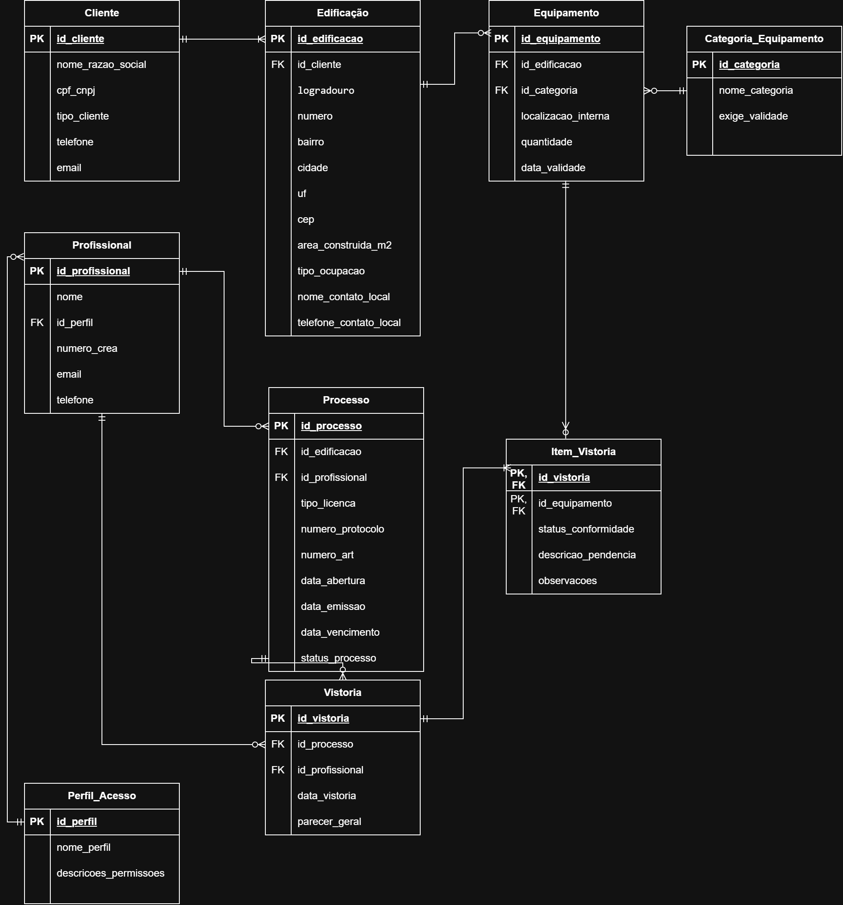

# FireTrack — Modelagem e Banco de Dados (AVCB/CLCB)


Projeto de arquitetura, normalização e implementação física de banco de dados relacional desenvolvido para o **FireTrack**, um sistema voltado à gestão de processos de regularização junto ao Corpo de Bombeiros (**AVCB** — Auto de Vistoria do Corpo de Bombeiros e **CLCB** — Certificado de Licença do Corpo de Bombeiros), controle de equipamentos preventivos e vistorias técnicas em campo.

---

## 1. Premissas do Minimundo

* **Gestão de Contratantes e Edificações:** Um cliente (pessoa física ou jurídica, com atendimento avulso ou contrato mensal) pode possuir uma ou mais edificações cadastradas, com endereço atomizado, área construída ($m^2$), tipo de ocupação e contato local.
* **Controle de Licenciamento (`Processo`):** Cada edificação possui processos de obtenção ou renovação de **AVCB** ou **CLCB**, vinculados a um engenheiro responsável técnico, contendo protocolo, número de ART, datas de abertura/emissão/vencimento e status evolutivo (*Em Análise*, *Comunique-se*, *Emitido*, *Vencido*).
* **Inventário Preventivo (`Equipamento`):** As edificações mantêm equipamentos de prevenção e combate a incêndio classificados por categoria, com controle de validade aplicado conforme a regra de cada grupo.
* **Vistorias e Checklist Técnico (`Vistoria` e `Item_Vistoria`):** Cada processo passa por vistorias técnicas em campo, nas quais cada equipamento inspecionado recebe status de conformidade, descrição de pendência e observações.

---

## 2. Evolução da Modelagem (1FN → 3FN)

### Modelo Conceitual / Inicial


### Modelo Lógico Relacional Normalizado (3FN)


O banco de dados `firetrack_db` foi estruturado em **9 tabelas relacionais**, eliminando grupos repetitivos (1FN), dependências parciais em chaves compostas (2FN) e dependências transitivas por meio das tabelas de domínio `Categoria_Equipamento` e `Perfil_Acesso` (3FN):

| Nível | Tabela | Chave Primária (PK) | Chaves Estrangeiras (FK) | Finalidade |
| :--- | :--- | :--- | :--- | :--- |
| **1 (Base)** | `Cliente` | `id_cliente` | — | Contratantes dos serviços de licenciamento (`cpf_cnpj` único). |
| **1 (Base)** | `Categoria_Equipamento` | `id_categoria` | — | Catálogo normalizado de categorias e regra `exige_validade`. |
| **1 (Base)** | `Perfil_Acesso` | `id_perfil` | — | Perfis de usuário e descrição de permissões do sistema. |
| **2** | `Edificacao` | `id_edificacao` | `id_cliente` | Imóveis vistoriados, endereço decomposto, área e ocupação. |
| **2** | `Profissional` | `id_profissional` | `id_perfil` | Engenheiros, técnicos vistoriadores e equipe administrativa (`CREA`). |
| **3** | `Equipamento` | `id_equipamento` | `id_edificacao`, `id_categoria` | Inventário de equipamentos instalados por edificação e validade. |
| **3** | `Processo` | `id_processo` | `id_edificacao`, `id_profissional` | Processos de AVCB/CLCB, protocolos, ART e vigência das licenças. |
| **4** | `Vistoria` | `id_vistoria` | `id_processo`, `id_profissional` | Inspeções realizadas em campo e parecer técnico geral. |
| **5 (Associativa)** | `Item_Vistoria` | `(id_vistoria, id_equipamento)` | `id_vistoria`, `id_equipamento` | Resultado individual de cada equipamento inspecionado na vistoria. |

---

## 3. Estrutura do Repositório

```text
avcbclbcproject/
├── scripts/
│   ├── 01_ddl_criacao_tabelas.sql       # Criação do schema firetrack_db e das 9 tabelas
│   ├── 02_dml_insert_povoamento.sql     # Carga inicial hierárquica de dados (5 níveis de FK)
│   ├── 03_dql_select_consultas.sql      # Consultas gerenciais com JOIN, WHERE, ORDER BY e LIMIT
│   └── 04_dml_update_delete.sql         # Atualizações e exclusões seguras com filtro WHERE
├── der-inicial.png.png                  # Diagrama da modelagem inicial
├── der-normalizado-3fn.png.png          # Diagrama lógico normalizado em 3FN
└── README.md                            # Documentação técnica do projeto
